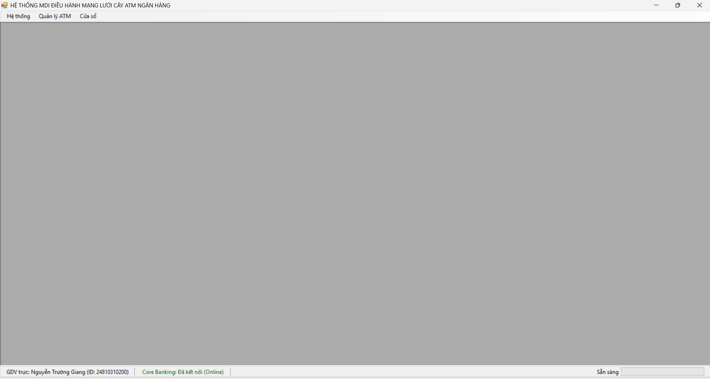
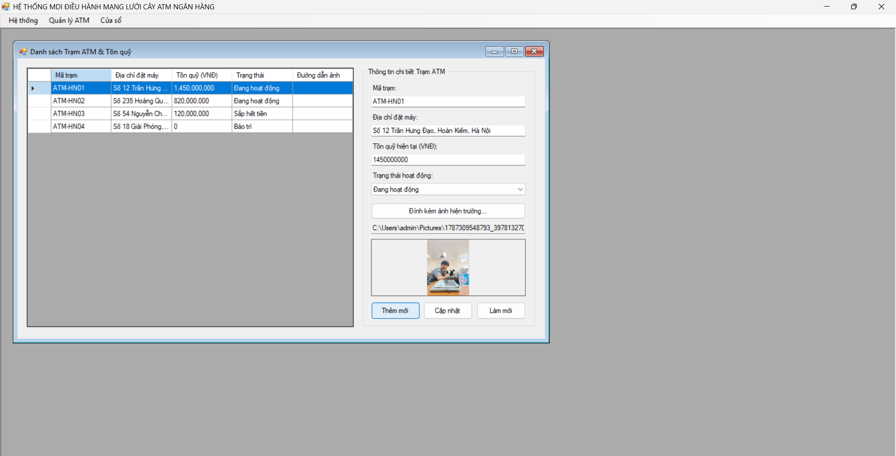
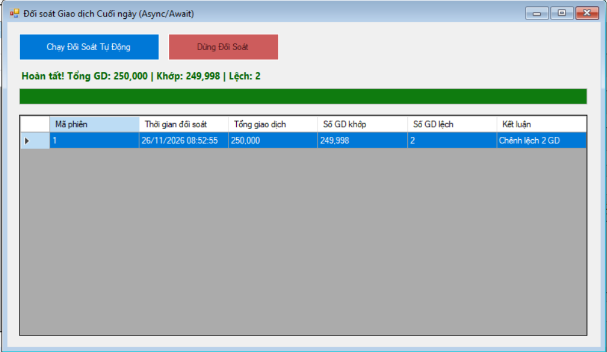
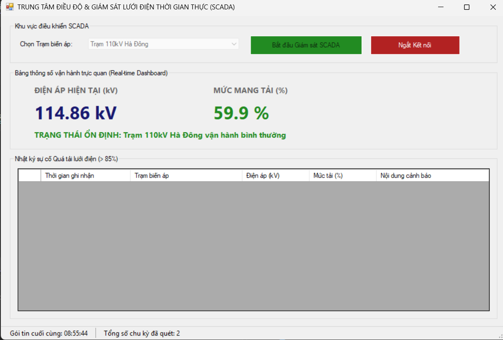
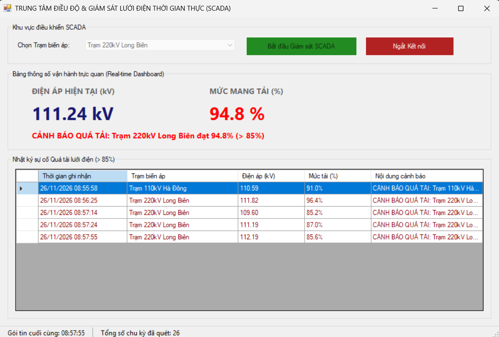

# BÀI TẬP THỰC HÀNH LẬP TRÌNH WINDOWS FORMS (BÀI 6.6 & BÀI 6.7)

- **Sinh viên thực hiện:** Nguyễn Trường Giang
- **Lớp:** D19CNPM3 — **MSV:** 24810310200

## 1. Nội dung bài tập
1. **Bài tập 6.6 — Hệ thống MDI điều hành mạng lưới cây ATM Ngân hàng:**
   - Xây dựng `frmBankAtmMain` (`IsMdiContainer = true`) tích hợp `MenuStrip` và `StatusStrip` (`ToolStripProgressBar`).
   - Kiểm soát mở Form con qua `this.MdiChildren`, gọi `Activate()` chống mở trùng lặp và hỗ trợ sắp xếp cửa sổ (`Cascade`, `TileHorizontal`, `TileVertical`).
   - Quản lý danh sách trạm ATM & đính kèm ảnh hiện trường qua `OpenFileDialog`.
   - Đối soát giao dịch cuối ngày bất đồng bộ bằng `async/await`, `Task.Run`, `IProgress<int>` và `CancellationTokenSource` giữ UI Thread mượt mà.
2. **Bài tập 6.7 — Trung tâm điều độ & giám sát lưới điện thời gian thực (SCADA):**
   - Khởi chạy vòng lặp thu thập thông số ngầm chu kỳ 2 giây/lần bằng `Task.Run`.
   - Tuân thủ nguyên tắc Cross-Thread Safety thông qua `this.InvokeRequired` và `this.Invoke(new Action(() => ...))`, loại bỏ hoàn toàn lỗi `InvalidOperationException`.
   - Tự động cảnh báo màu Đỏ và ghi nhật ký vào `DataGridView` + SQL Server khi mức mang tải vượt ngưỡng `85%`.

## 3. Ảnh chụp màn hình chức năng

### Ảnh 1: Giao diện MDI chính & Sắp xếp cửa sổ con (Bài 6.6)

### Ảnh 2: Quản lý Trạm ATM & Đính kèm ảnh hiện trường bằng OpenFileDialog (Bài 6.6)

### Ảnh 3: Đối soát giao dịch bất đồng bộ & Thanh tiến trình StatusStrip (Bài 6.6)

### Ảnh 4: Giám sát lưới điện SCADA trạng thái ổn định (Bài 6.7)

### Ảnh 5: Cảnh báo Quá tải (> 85%) & Nhật ký sự cố Cross-Thread Safe (Bài 6.7)
